<!-- _class: titlepage -->

# Algoritmos evolutivos

## Robótica - Grado en Ingeniería de Computadores

### Departamento de Sistemas Informáticos

#### E.T.S.I. de Sistemas Informáticos - Universidad Politécnica de Madrid

---

# Introducción<!--_class: section-->

---

# Definición

Los **algoritmos evolutivos (EAs)** son técnicas metaheurísticas para resolver problemas de optimización, búsqueda y *machine learning*. Estas técnicas se inspiran en procesos que suceden en la naturaleza, como la **selección natural**, la supervivencia del **más fuerte** y la **transmisión genética** de los rasgos de los padres a sus hijos.

- Desde un punto de vista **matemático**, los EAs se consideran métodos **numéricos**
- Desde un punto de vista **computacional**, estas técnicas se consideran programas **software**
- Desde el punto de vista de otras **aplicaciones**, los EAs son simplemente **herramientas** disponibles para su uso

---

# Aplicaciones

Una de las principales **ventajas** de estas técnicas es su gran aplicabilidad a la resolución de **multitud de tareas**. Algunos ejemplos son:

- Optimización numérica, como el **problema de la mochila** o el **problema del viajante**
- Particionado de **grafos**
- Diseño de circuitos **VLSI (*Very Large Scale Integration*)**: proceso de crear un circuito integrado compuesto por cientos de miles de transistores en un único chip
- **Diseño y entrenamiento** de redes neuronales y arquitecturas profundas
- **Telecomunicaciones**: redes de sensores, distribución de antenas de telecomunicación, etc.

---

# Ventajas e inconvenientes

Ventajas:

- Trabajan sobre la **codificación** de un problema
- Aplicabilidad **muy alta**, basta con encontrar una codificación apropiada para tu problema
- No se obtiene solo una buena solución, sino toda una **población de buenas soluciones**
- Explotación y exploración del espacio de **búsqueda configurable**

Inconvenientes:

- **No está asegurado** encontrar un óptimo
- Hay muchas **líneas de investigación** abiertas
- Alta **demanda computacional**

---

# Elementos de un algoritmo evolutivo<!--_class: section-->

---

# Elementos de un algoritmo evolutivo

- **Población**: conjunto de puntos del espacio de búsqueda en un momento dado del proceso de evolución
- **Individuo**: cada uno de los puntos del espacio de búsqueda
- **Gen**: cada uno de los parámetros de un individuo
- **Alelo**: cada uno de los posibles valores de un gen
- **Cromosoma**: individuo

---

# Genotipo vs. fenotipo

**Genotipo**

- **Espacio de búsqueda**: toda la información genética disponible, es decir, todas las soluciones posibles a nuestro problema

**Fenotipo**

- **Espacio de soluciones**: la expresión física de las características de las soluciones

---

# Codificación de individuos

A la hora de aplicar un **algoritmo evolutivo** uno de los pasos esenciales es pensar cómo se van a **codificar las soluciones**.

En este punto definimos **individuo** como cada una de las soluciones **propuestas** por el algoritmo.

- Ejemplo: **receta de galletas**

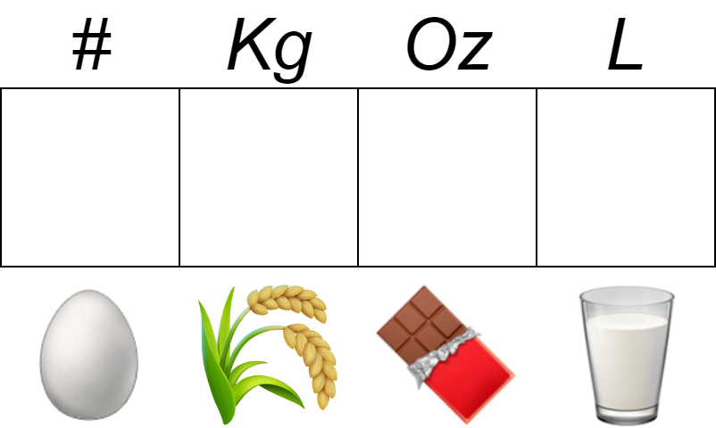

---

# Codificación de individuos

- Ejemplo: **receta de galletas**

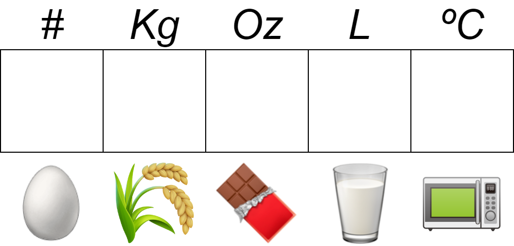

**¿Y si lo codificamos así?**

---

# Instanciación de soluciones

Como cada individuo representa **una solución**, los individuos deberán ser **instanciados** con ciertos valores.

Ejemplo: **receta de galletas**

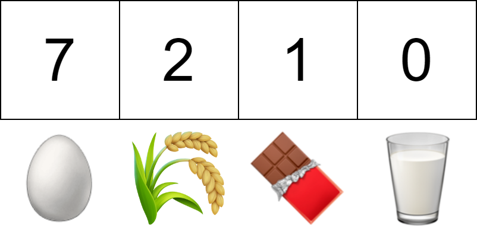

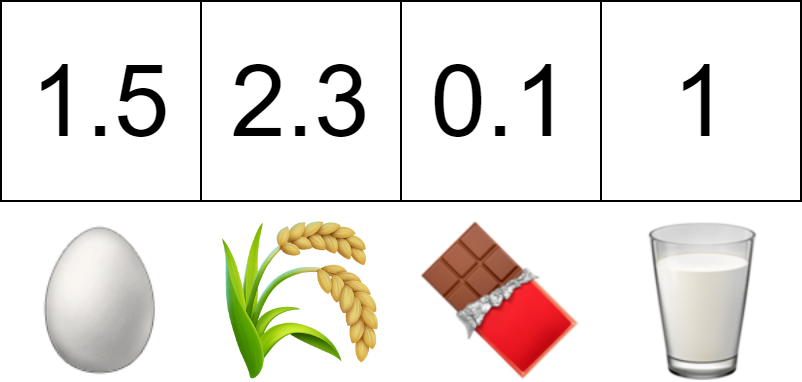

---

# Ejemplo: problema de la mochila

Se necesitan **seleccionar objetos** con cierto valor y peso. El objetivo es **optimizar el valor total**. No se puede superar el **peso máximo a transportar**.

---

# Ejemplo: problema de la mochila

**¿Cómo codificamos cada solución?**

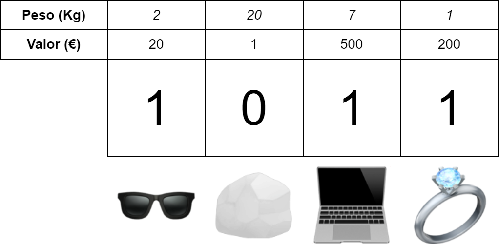

---

# Codificación real y binaria

Existen dos maneras de codificar los **genes** de cada individuo:

- **Codificación real** (alfabeto infinito)

- **Codificación binaria** (alfabeto finito)

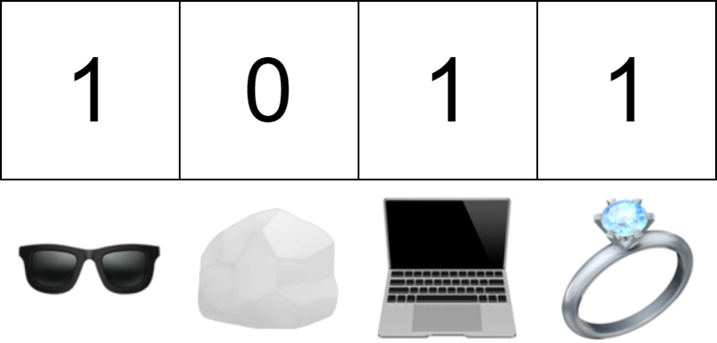

---

# Individuos no válidos

Dependiendo de la **codificación** encontraremos **individuos no válidos** entre las posibles soluciones propuestas:

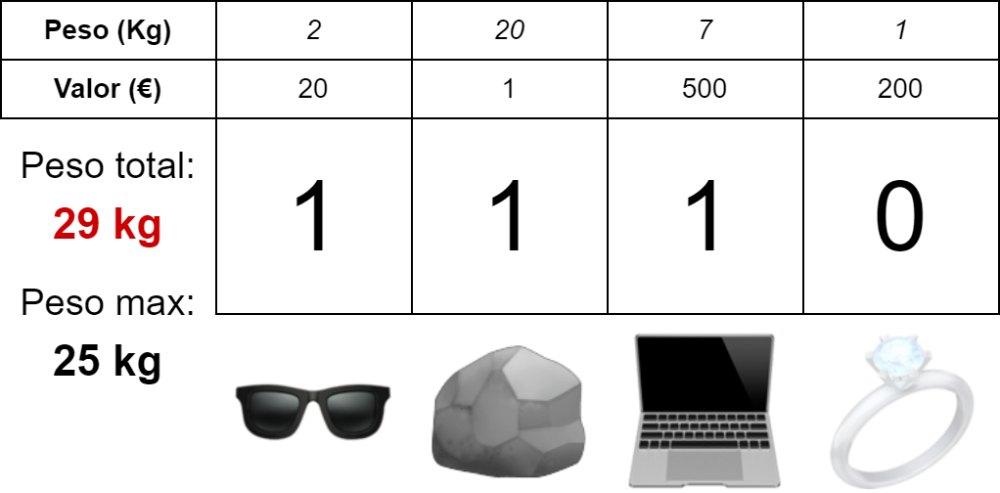

---

# Individuos no válidos: operadores de reparación

Los **operadores de reparación** buscan convertir **individuos no válidos** en **válidos**.

En el ejemplo del problema de la mochila, por ejemplo, **eliminar el elemento más pesado**:

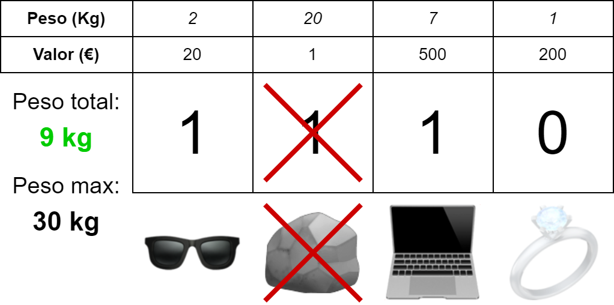

---

# Individuos no válidos

¿Qué se puede hacer con los individuos no válidos?

- **Eliminarlos**: ineficiente
- **Valor malo de adaptación**: puede converger a **soluciones malas**
- **Repararlos**: difíciles de buscar, no siempre es posible. Puede dar lugar a comportamientos extraños

---

# Codificación biyectiva

La **codificación biyectiva** sucede cuando cada **solución de las posibles** tiene una **única codificación**. Es la **situación ideal**.

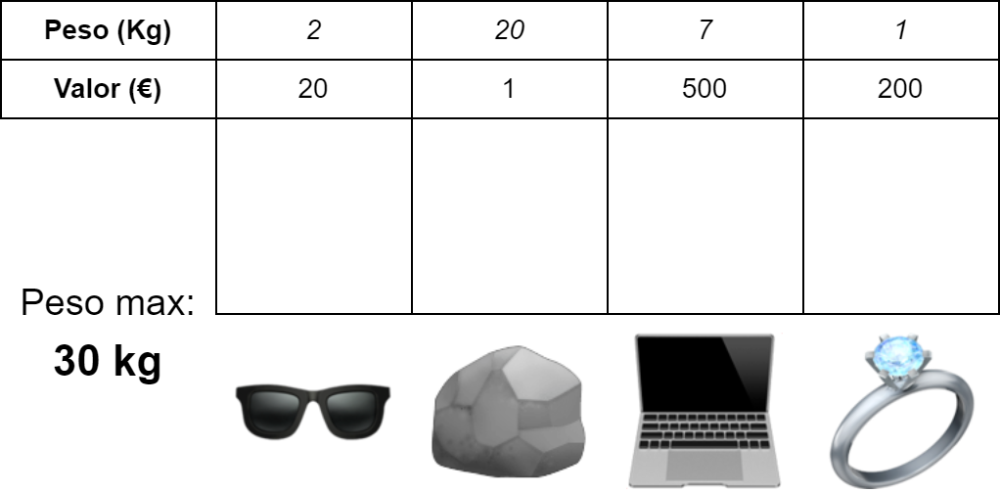

---

# Codificación inyectiva y sobreyectiva

En la **codificación inyectiva** cada **solución** está codificada por **un individuo** como máximo.

- Esto genera que haya **soluciones** inaccesibles

En la **codificación sobreyectiva** cada **solución** está codificada por **un individuo** como mínimo.

- Esto genera que haya varios individuos que generan la misma **solución**
- Se aumenta el **espacio de búsqueda**
- Si **varios individuos** codifican el **óptimo**, este es más fácil de encontrar

---

# Función de fitness

La **función de fitness** es una **métrica que evalúa** cómo de óptima es cada una de las soluciones propuestas:

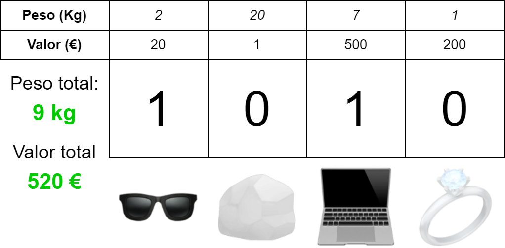

---

# Función de fitness

**No siempre** es fácil definir el fitness:

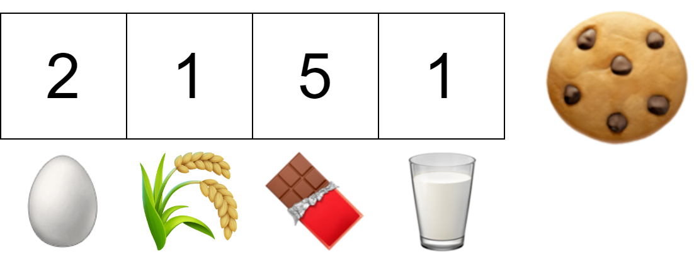

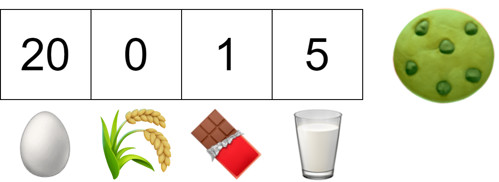

---

# Función de fitness

La **función de fitness** es uno de los elementos **más importantes** a la hora de diseñar los algoritmos evolutivos. Deberá medir la **calidad** de las soluciones parciales exploradas.

Esta función **depende del problema** y por lo tanto no hay una regla de oro para crearla. Sin embargo, sí hay ciertas características deseables:

- **Escalado**: debe separar al máximo los distintos valores de fitness de los individuos
- **Compartición**: las soluciones parecidas deben tener valores similares
- **Ranking**: la población se deberá poder ordenar respecto a su calidad, usando el fitness

---

# Fitness para el problema de las n reinas

¿Qué función de fitness se puede diseñar para el problema de las n reinas?

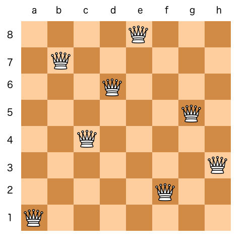

---

# Fitness para el problema de las n reinas

**Fitness**: 1 si solución encontrada, 0 si no.

- **Escalado**: **no se cumple**, ya que la mayoría de individuos valdrán 0
- **Compartición**: **sí se cumple**, pero la agrupación será única
- **Ranking**: **no se cumple**, no hay gradiente de soluciones

---

# Fitness para el problema de las n reinas

**Fitness**: número de reinas en jaque.

- **Escalado**: **sí se cumple**, los individuos distintos tendrán valores distintos
- **Compartición**: **sí se cumple**, soluciones con el mismo número de reinas en jaque tienen el mismo valor
- **Ranking**: **sí se cumple**, a menor número, mejor solución

---

# Fitness para el problema de las n reinas

**Fitness**: número de reinas **NO** en jaque.

Los algoritmos evolutivos pueden **maximizar** o **minimizar** la función de fitness.

---

# Algoritmo de optimización<!--_class: section-->

---

# Funcionamiento de algoritmos evolutivos

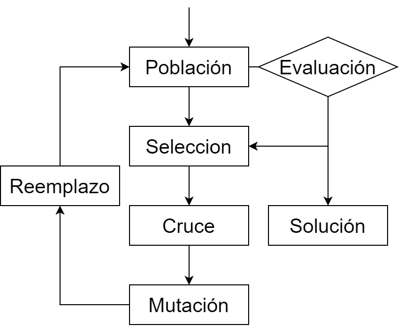

---

# Funcionamiento de algoritmos evolutivos

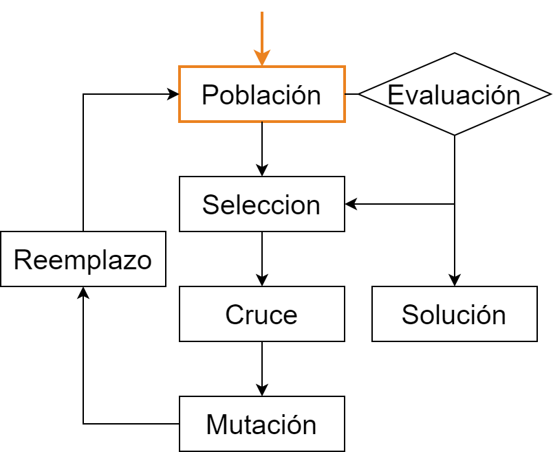

**Generación de población**

Se genera una población inicial aleatoriamente.

---

# Funcionamiento de algoritmos evolutivos

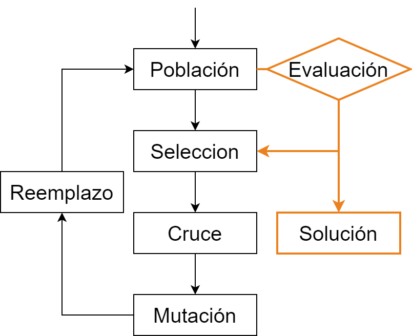

**Evaluación**

Se aplica la función de fitness a todos los individuos y se evalúa si se ha llegado a la convergencia del algoritmo.

---

# Funcionamiento de algoritmos evolutivos

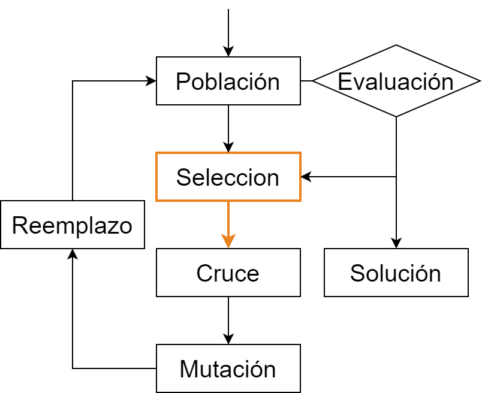

**Selección**

Se seleccionan los individuos mejor adaptados para su cruce.

---

# Funcionamiento de algoritmos evolutivos

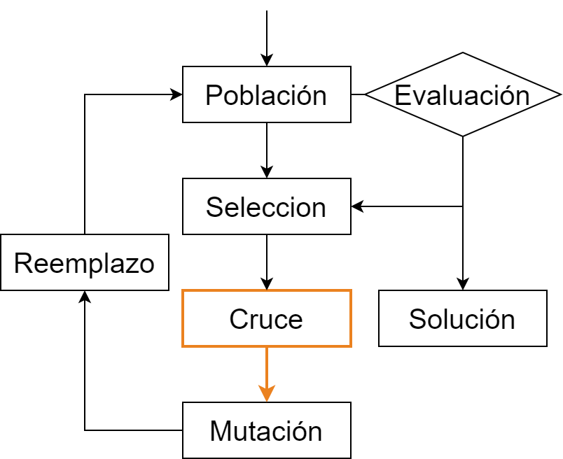

**Cruce**

Se cruzan los genes de los individuos seleccionados.

---

# Funcionamiento de algoritmos evolutivos

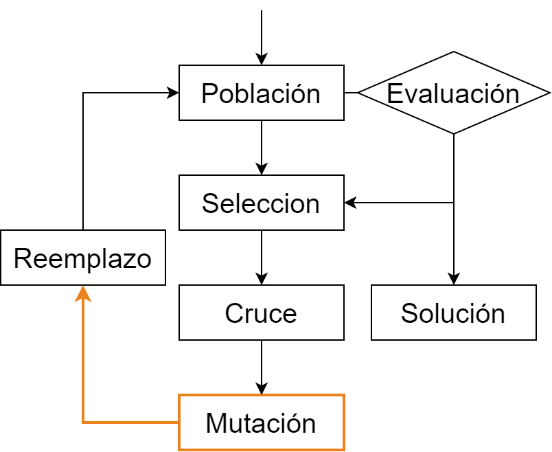

**Mutación**

Aleatoriamente se modifican los valores de ciertos genes de la descendencia.

---

# Funcionamiento de algoritmos evolutivos

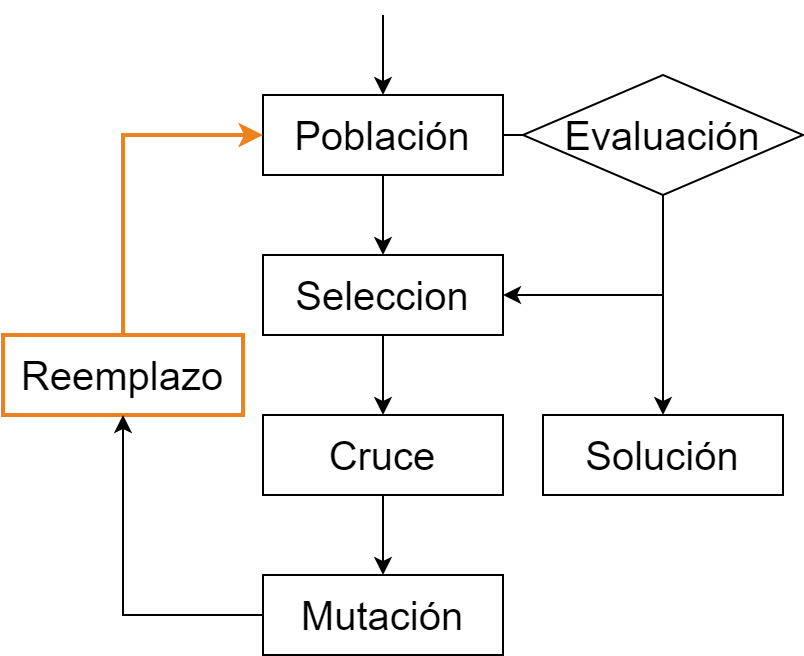

**Reemplazo**

Se reemplaza total o parcialmente la población inicial.

---

# Operador de selección

Existen distintos **operadores de selección**; el más sencillo es el método proporcional.

La **probabilidad de escoger cada individuo** es proporcional a su fitness:

$$Prob_i = \frac{fitness_i}{\sum fitness}$$

---

# Operador de mutación

Dependiendo de la codificación se pueden aplicar distintos **operadores de mutación**

- **Alfabeto finito**
  - Se cambia el **valor del gen** por otro del alfabeto
- **Alfabeto infinito**
  - Se **suma o resta** cierto valor (aleatorio o no) a dicho gen
  - Se reemplaza por otro valor **aleatorio**

---

# Operador de cruce

Existen distintas posibilidades para el **operador de cruce**. El más sencillo es el operador de cruce en dos puntos:

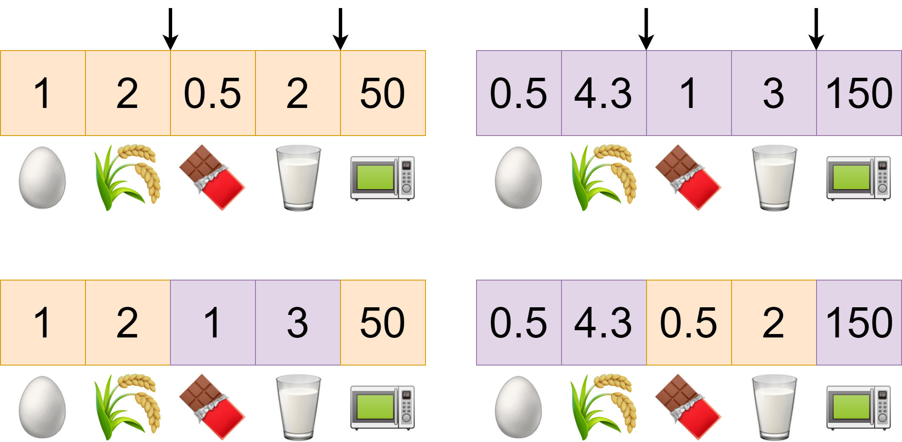

---

# Operador de reemplazo

El **operador de reemplazo** sustituye un **X%** de la población por **nuevos individuos generados**.

- **Elitismo**
  - Consiste en **asegurarse de mantener** los mejores X individuos de la población inicial

---

# Búsqueda de soluciones

Una vez aplicado el proceso de optimización del algoritmo genético existen **muchas variables y probabilidades a cambiar**, por ejemplo la **probabilidad de mutación**.

De cada problema dependerá encontrar una **solución óptima**; sin embargo, aparecen aquí dos conceptos:

**Búsqueda local**

Consiste en buscar soluciones **cercanas** a las actuales. Es un proceso de **refinación**.

Se escogen valores **conservadores** de mutación, cruce y reemplazo.

**Búsqueda global**

Consiste en buscar soluciones **alejadas** de las actuales. Es un proceso de **búsqueda**.

Se escogen valores **exploratorios** de mutación, cruce y reemplazo.

---

# Búsqueda global

El problema de la búsqueda global es que tiene un **comportamiento errático** y puede no encontrar soluciones.

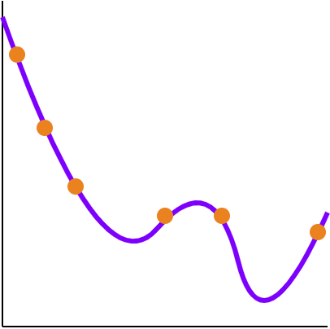

---

# Búsqueda local

El problema de la búsqueda local es que tiene una **lenta convergencia** y puede caer en **mínimos locales**.

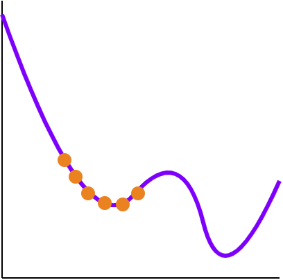

---

# Estrategia de búsqueda

Lo más habitual es **cambiar los valores del algoritmo** para pasar de una búsqueda global a local.

- Al principio, se realizará una **búsqueda exploratoria** que busque distintas soluciones
- A medida que el algoritmo avance, se **explorarán en profundidad** dichas soluciones, buscando el **óptimo global**

---

# ¡GRACIAS!<!--_class: endpage-->